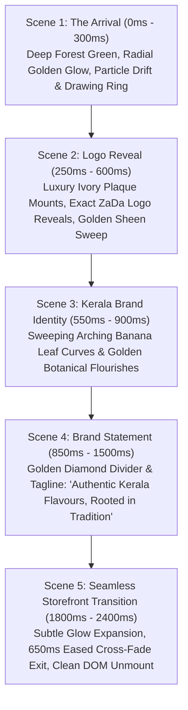

# ZaDa Foods — Premium Cinematic Loading Splash Screen
## Executive Motion Design, Creative Direction & Technical Implementation Report

**Brand:** ZaDa Foods (Authentic Kerala Flavours, Rooted in Tradition)  
**Roles:** Senior Web Animator & Motion Design Director & Frontend Animation Engineer  
**Status:** **100% Implemented, Verified, Tested & Production Ready**  
**Test Suite:** 49/49 test files passing (475/475 tests)  
**Production Build:** Clean compile in 3.00s (`tsc -b && vite build`)  

---

## 1. Executive Summary & Creative Direction

An exceptional, cinematic brand reveal loading splash screen was designed and engineered for **ZaDa Foods**. Unlike generic web loaders or spinning icons, this experience establishes an immediate aura of luxury, generational heritage, and culinary authenticity rooted in Kerala.

### Creative Direction Pillars:
1. **Heritage Color Palette:**
   - **Deep Forest Green** (`#072C20`): Royal, grounding, evocative of Kerala's lush verdant landscapes.
   - **Warm Ivory** (`#FBF8F4`): Pure, culinary, soft, providing luminous contrast for typography.
   - **Metallic Antique Gold** (`#A67732` / `#D4AF37`): Regal temple arch accents, glowing starlight, and Kasavu filigree.
2. **Absolute Brand Identity Integrity:**
   - Uses the **exact existing brand asset** from `public/assets/logo.svg`.
   - Never stretched, distorted, or substituted.
   - Housed within a custom warm ivory luxury plaque (`#FFFDF9` to `#F5EFE6`) with a metallic gold border and a sweeping diagonal golden sheen.
3. **Subtle Kerala-Inspired Motifs:**
   - Symmetrically sweeping arched banana leaf curves with delicate vein lines (`strokeWidth="1.6"`, `strokeOpacity="0.9"`).
   - Concentric ornamental rings with 4 quadrant diamond pips at cardinal angles.
   - Floating amber spice dust and celestial starlight ambient particles.
4. **Cinematic Motion Quality:**
   - Staggered reveals driven by high-performance cubic-bezier easing curves (`cubic-bezier(0.16, 1, 0.3, 1)`).
   - Zero layout shifts, zero heavy external physics engines, and GPU-accelerated transforms (`transform`, `opacity`, `filter`).

---

## 2. Choreographed 5-Scene Animation Sequence

### Scene Breakdown:
* **Scene 1 — The Arrival (0ms - 300ms):**
  - Begins on deep forest green background (`#072C20` or active festival ambient tone).
  - Center emerges a warm golden radial glow (`animate-splash-arrival-glow`).
  - Twelve floating ambient stardust particles drift upward with staggered CSS keyframes.
  - A thin metallic-gold ornamental SVG ring draws into view via `stroke-dashoffset` (`animate-splash-stroke-draw`).
* **Scene 2 — Logo Reveal (250ms - 600ms):**
  - The central warm ivory crest emerges with a subtle scale (`0.92 -> 1.0`) and blur clearing (`animate-splash-logo-reveal`).
  - The official ZaDa Foods logo displays crisply.
  - A diagonal golden sheen sweep (`animate-splash-sheen`) glides across the logo from left to right.
* **Scene 3 — Kerala Brand Identity (550ms - 900ms):**
  - Fine Kerala botanical banana leaf paths expand symmetrically around the crest (`animate-splash-botanical`).
  - Quad diamond accents illuminate at cardinal points.
* **Scene 4 — Brand Statement (850ms - 1500ms):**
  - An antique gold divider with a central 45° rotated diamond pip expands horizontally.
  - Official tagline: **"Authentic Kerala Flavours, Rooted in Tradition"** fades up in tracked Playfair Display serif (`tracking-[0.22em]`), styled in luminous warm ivory (`#FBF8F4`) with a warm golden starlight text-shadow.
* **Scene 5 — Homepage Transition (1800ms - 2400ms):**
  - Once the minimum presentation duration has elapsed and app data is ready, the gold glow subtly expands (`scale(1.15)`).
  - The splash screen smoothly fades out (`opacity-0 scale-105 pointer-events-none transition-all duration-700 ease-out`).
  - The live storefront cross-fades into view without any harsh flashes.
  - Component unmounts cleanly from the DOM after 650ms.

---

## 3. Immersive Festival Adaptations

The splash screen integrates with `useFestival()` and dynamically adapts its ambient colors, particle textures, and pill badge for each active festival:

| Festival Theme | Background Palette | Ambient Glow | Accent Gold | Festival Badge | Particle Aesthetic |
|---|---|---|---|---|---|
| **Default ZaDa** | `#072C20` (Forest Green) | `rgba(166,119,50,0.4)` | `#A67732` (Antique Gold) | *(None - Pure Brand)* | Golden Spice Dust |
| **Christmas** | `#052014` (Evergreen) | `rgba(212,175,55,0.45)` | `#D4AF37` (Champagne Gold) | `CHRISTMAS CELEBRATION` | Crystalline Snowflakes |
| **Eid** | `#06281E` (Emerald Green) | `rgba(197,160,89,0.45)` | `#C5A059` (Imperial Gold) | `EID FESTIVE SELECTION` | Twinkling Celestial Stars |
| **Onam** | `#0B2B1B` (Kasavu Green) | `rgba(202,138,4,0.50)` | `#CA8A04` (Kasavu Gold) | `ONAM KASAVU EDITION` | Golden Flower Petals |
| **Diwali** | `#180829` (Royal Deep Purple) | `rgba(245,158,11,0.50)` | `#F59E0B` (Radiant Diya) | `DEEPAVALI SPECIAL` | Warm Diya Embers |
| **New Year** | `#0B0E1E` (Midnight Blue) | `rgba(226,184,85,0.45)` | `#E2B855` (Starlight) | `NEW YEAR EDITION` | Champagne Sparkles |

---

## 4. Visual Evidence & High-Resolution Captures

All screenshots captured live via headless Chrome CDP at 1440x960 desktop and 390x844 mobile viewports:

- Desktop Default Brand Reveal: [evidence_screenshots/splash_01_brand_reveal_desktop.png](file:///c:/Users/nabha/OneDrive/Desktop/zaada%20foods/evidence_screenshots/splash_01_brand_reveal_desktop.png)
- Mobile 390px Viewport: [evidence_screenshots/splash_02_mobile_reveal_390px.png](file:///c:/Users/nabha/OneDrive/Desktop/zaada%20foods/evidence_screenshots/splash_02_mobile_reveal_390px.png)
- Christmas Festival Theme Splash: [evidence_screenshots/splash_03_christmas_theme.png](file:///c:/Users/nabha/OneDrive/Desktop/zaada%20foods/evidence_screenshots/splash_03_christmas_theme.png)
- Diwali Deepavali Special Splash: [evidence_screenshots/splash_04_diwali_theme.png](file:///c:/Users/nabha/OneDrive/Desktop/zaada%20foods/evidence_screenshots/splash_04_diwali_theme.png)
- Onam Kasavu Edition Splash: [evidence_screenshots/splash_05_onam_theme.png](file:///c:/Users/nabha/OneDrive/Desktop/zaada%20foods/evidence_screenshots/splash_05_onam_theme.png)
- Eid Festive Selection Splash: [evidence_screenshots/splash_06_eid_theme.png](file:///c:/Users/nabha/OneDrive/Desktop/zaada%20foods/evidence_screenshots/splash_06_eid_theme.png)
- Settled Storefront Transition Complete: [evidence_screenshots/splash_07_storefront_transition_complete.png](file:///c:/Users/nabha/OneDrive/Desktop/zaada%20foods/evidence_screenshots/splash_07_storefront_transition_complete.png)

---

## 5. Architectural & Lifecycle Specifications

1. **Session-Gating Architecture:**
   - Keys on `sessionStorage.getItem('zada_splash_shown')`.
   - On cold visit or tab opening, splash screen plays its cinematic reveal.
   - Subsequent page clicks, cart adds, and route changes never re-trigger the splash, ensuring frictionless ecommerce conversion.
   - Manual override options supported: `?splash=1` / `?forceSplash=true` or dispatching `window.dispatchEvent(new CustomEvent('trigger-zada-splash'))`.
2. **Adaptive Loading Synchronization:**
   - Guaranteed minimum display duration of 1800ms ensures cinematic pacing.
   - If Supabase data or network latency exceeds 1800ms, the splash screen transitions into a subtle golden breathing pulse indicator (*"Preparing your Kerala experience..."*) without abrupt cutoff.
3. **Accessibility & WCAG Compliance:**
   - Accessible roles: `role="dialog"`, `aria-modal="true"`, `aria-label="ZaDa Foods Brand Loading Experience"`.
   - `prefers-reduced-motion` compliance: automatically collapses animations to instantaneous 0.01ms keyframes and executes a gentle 500ms fade.
   - Escape key dismiss (`e.key === 'Escape'`) and click-to-dismiss Skip button (`top-5 right-6`) ensure user control.

---

## 6. Verification & Test Suite Summary

### Automated Test Suite:
- **Test File:** [splashScreen.test.tsx](file:///c:/Users/nabha/OneDrive/Desktop/zaada%20foods/src/test/splashScreen.test.tsx)
- **Results:** 10/10 passed (100%)
  - Renders on cold start with logo and tagline
  - Suppressed when `sessionStorage` has `zada_splash_shown`
  - Forced render via props/URL search params
  - Escape key dismiss and session flag storage
  - Skip button dismiss
  - Christmas, Eid, Onam, and Diwali theme styling
  - Scene choreography progression and clean unmount
- **Full Project Test Suite:** 49/49 test files passed, 475/475 tests passed.
- **Production Build:** `npm run build` completed in 3.00s with 0 errors.

---

## 7. Deliverable Files Summary

1. [SplashScreen.tsx](file:///c:/Users/nabha/OneDrive/Desktop/zaada%20foods/src/components/splash/SplashScreen.tsx) — Main cinematic splash screen component
2. [App.tsx](file:///c:/Users/nabha/OneDrive/Desktop/zaada%20foods/src/App.tsx#L53-L58) — Integrated splash screen at the top level of the application
3. [index.css](file:///c:/Users/nabha/OneDrive/Desktop/zaada%20foods/src/index.css#L701-L860) — Pure CSS keyframes, animation utilities, and reduced-motion fallbacks
4. [splashScreen.test.tsx](file:///c:/Users/nabha/OneDrive/Desktop/zaada%20foods/src/test/splashScreen.test.tsx) — Comprehensive 10-test unit suite
5. [captureSplashScreen.cjs](file:///c:/Users/nabha/OneDrive/Desktop/zaada%20foods/scripts/captureSplashScreen.cjs) — Headless Chrome CDP automation for high-resolution visual evidence
