# ZaDa Foods — Complete Database Architecture & Schema Specification

This document provides the authoritative schema documentation and entity relationship architecture for the fresh ZaDa Foods Supabase database.

---

## 1. Visual Entity-Relationship Diagram (Mermaid ERD)

```mermaid
erDiagram
    categories ||--o{ subcategories : "has"
    categories ||--o{ products : "contains"
    subcategories ||--o{ products : "categorizes"
    products ||--o{ product_variants : "offers"
    products ||--o{ product_images : "showcases"
    products ||--o{ product_tags : "tagged"
    products ||--o{ product_attributes : "specifies"
    products ||--o{ reviews : "reviewed_in"
    products ||--o{ order_items : "sold_in"

    product_variants ||--o{ inventory_movements : "tracked_by"
    product_variants ||--o{ stock_adjustments : "adjusted_by"
    product_variants ||--o{ cart_items : "added_to"
    product_variants ||--o{ combo_items : "bundled_in"
    product_variants ||--o{ order_items : "fulfilled_in"

    auth_users ||--|| profiles : "identifies"
    auth_users ||--o{ addresses : "saves"
    auth_users ||--o{ orders : "places"
    auth_users ||--o{ wishlists : "saves"
    auth_users ||--o{ carts : "owns"
    auth_users ||--|| admin_accounts : "authorized_as"
    auth_users ||--o{ admin_roles : "assigned"
    auth_users ||--o{ admin_permissions : "granted"

    orders ||--o{ order_items : "comprises"
    orders ||--o{ order_status_history : "tracks"
    orders ||--o{ payment_transactions : "paid_via"
    orders ||--o{ refunds : "refunded_via"
    orders ||--o{ guest_order_tokens : "secured_by"

    carts ||--o{ cart_items : "contains"
    combos ||--o{ combo_items : "bundles"

    categories {
        uuid id PK
        text slug UK
        text name
        text description
        text image_url
        int display_order
        boolean is_active
        timestamptz created_at
        timestamptz updated_at
    }

    subcategories {
        uuid id PK
        uuid category_id FK
        text slug UK
        text name
        text description
        int display_order
        boolean is_active
        timestamptz created_at
        timestamptz updated_at
    }

    products {
        uuid id PK
        uuid category_id FK
        uuid subcategory_id FK
        text name
        text slug UK
        text tagline
        text description
        text ingredients
        jsonb nutrition_facts
        text storage_instructions
        int shelf_life_days
        boolean is_preservative_free
        boolean is_coconut_oil_made
        boolean is_bestseller
        boolean is_on_offer
        boolean is_cod_eligible
        boolean is_published
        boolean is_active
        numeric average_rating
        int review_count
        timestamptz deleted_at
        timestamptz created_at
        timestamptz updated_at
    }

    product_variants {
        uuid id PK
        uuid product_id FK
        text sku UK
        numeric weight_value
        text weight_unit
        text weight_label
        numeric selling_price
        numeric mrp
        numeric discount_percentage
        int stock_quantity
        int low_stock_threshold
        boolean is_default
        boolean is_active
        int display_order
        timestamptz created_at
        timestamptz updated_at
    }

    inventory_movements {
        uuid id PK
        uuid variant_id FK
        text movement_type
        int quantity_change
        int previous_stock
        int new_stock
        uuid order_id FK
        text reason
        uuid created_by
        timestamptz created_at
    }

    profiles {
        uuid id PK
        text email UK
        text full_name
        text phone
        text avatar_url
        text role
        timestamptz created_at
        timestamptz updated_at
    }

    addresses {
        uuid id PK
        uuid user_id FK
        text tag
        text recipient_name
        text phone
        text street_address
        text landmark
        text city
        text state
        text postal_code
        boolean is_default
        timestamptz created_at
        timestamptz updated_at
    }

    orders {
        uuid id PK
        text order_number UK
        uuid user_id FK
        text customer_name
        text customer_email
        text customer_phone
        jsonb shipping_address
        text delivery_method
        text payment_mode
        text payment_status
        text fulfillment_status
        numeric subtotal_amount
        numeric discount_amount
        text coupon_code
        numeric shipping_charge
        numeric total_amount
        numeric cod_advance_amount
        numeric cod_advance_paid
        numeric cod_remaining_amount
        varchar cod_advance_payment_status
        text courier_name
        text tracking_number
        text tracking_url
        text admin_notes
        timestamptz created_at
        timestamptz updated_at
    }

    order_items {
        uuid id PK
        uuid order_id FK
        uuid product_id FK
        uuid variant_id FK
        text product_name
        text variant_weight_label
        text image_url
        numeric unit_price
        numeric mrp
        int quantity
        numeric line_total
        timestamptz created_at
    }

    coupons {
        uuid id PK
        text code UK
        text description
        text discount_type
        numeric discount_value
        numeric max_discount_amount
        numeric min_order_amount
        boolean is_first_order_only
        int usage_limit
        int times_used
        boolean is_active
        timestamptz valid_until
        timestamptz created_at
        timestamptz updated_at
    }

    pricing_rules {
        uuid id PK
        text name
        text description
        text rule_type
        int buy_quantity
        int get_quantity
        numeric discount_percentage
        numeric min_cart_total
        uuid target_category_id FK
        uuid target_product_id FK
        boolean is_active
        timestamptz created_at
        timestamptz updated_at
    }

    combos {
        uuid id PK
        text name
        text slug UK
        text tagline
        text description
        uuid combo_product_id FK
        text discount_type
        numeric discount_value
        text image_url
        boolean is_active
        timestamptz created_at
        timestamptz updated_at
    }

    homepage_banners {
        uuid id PK
        text title
        text subtitle
        text headline
        text badge_text
        text cta_text
        text cta_url
        text image_url
        text background_color
        int display_order
        boolean is_active
        timestamptz created_at
        timestamptz updated_at
    }

    category_banners {
        uuid id PK
        uuid category_id FK
        text category_slug UK
        text title
        text subtitle
        text eyebrow
        text background_color
        text text_color
        text image_url
        int display_order
        boolean is_active
        timestamptz created_at
        timestamptz updated_at
    }

    festival_themes {
        uuid id PK
        text slug UK
        text name
        text preset
        boolean is_active
        text intensity
        text primary_color
        text accent_color
        text banner_url
        jsonb motifs
        timestamptz start_date
        timestamptz end_date
        timestamptz created_at
        timestamptz updated_at
    }

    reviews {
        uuid id PK
        uuid product_id FK
        uuid user_id FK
        text reviewer_name
        int rating
        text review_title
        text review_text
        boolean is_verified_purchase
        boolean is_approved
        boolean is_featured_on_pdp
        timestamptz created_at
        timestamptz updated_at
    }

    store_settings {
        text key PK
        jsonb value
        timestamptz updated_at
    }

    admin_accounts {
        uuid id PK
        text email UK
        text full_name
        text role
        text status
        boolean is_active
        timestamptz created_at
        timestamptz updated_at
    }
```

---

## 2. Module Specifications

### Module A: Product Catalogue & Organization
1. **`categories`**: Defines high-level groupings (Chips, Traditional Sweets, Authentic Halwa, Spices & Blends, Pickles, Gift Packs).
2. **`subcategories`**: Granular divisions (e.g., Banana Chips, Tapioca, Jackfruit under Chips).
3. **`products`**: Root product details, descriptions, ingredients, nutrition facts, shelf life, badges, and soft-deletion tracking (`deleted_at`).
4. **`product_variants`**: Weight options (250g, 500g, 1kg), distinct SKU identifiers, selling price, MRP, and real-time inventory count.
5. **`product_images`**: Multi-image gallery with primary thumbnail designation.
6. **`product_tags`** & **`product_attributes`**: Search and filtering metadata.

### Module B: Atomic Inventory & Movement Audit
1. **`inventory_movements`**: Immutable audit ledger recording every stock transition (`IN`, `OUT`, `SALE`, `RESTOCK`, `ADJUSTMENT`, `DAMAGE`) with before/after quantities and order linkage.
2. **`stock_adjustments`**: Manual administrative stock override tracking with mandatory audit reasons.
3. **Atomic Operations**: Protected by `atomic_order_inventory_decrement` and `atomic_order_cancellation_restock` using explicit row-level locking (`FOR UPDATE`) sorted by variant ID to eliminate database deadlocks.

### Module C: Customer Profiles & Addresses
1. **`profiles`**: Linked directly to `auth.users(id)`. Protected by `protect_profiles_role_modification()` trigger preventing unauthorized privilege escalation.
2. **`addresses`** (with `customer_addresses` view): Multiple saved delivery locations per customer with default tag support.
3. **`customer_preferences`**: Communication opt-ins (WhatsApp, SMS, Email).

### Module D: Checkout & Financial Transactions
1. **`orders`**: Stores master order details, delivery method, payment status, fulfilment status, and full COD advance parameters.
2. **`order_items`**: Line items snapshotting unit price, MRP, weight label, and line totals at order creation.
3. **`guest_order_tokens`**: Provides tamper-proof guest order status tracking using cryptographic HMAC-SHA256 tokens (`got_*`).
4. **`payment_transactions`**: Razorpay gateway orders, payment IDs, verification signatures, and raw responses.
5. **`refunds`**: Audit log of full or partial payment returns.

### Module E: Cart & Wishlist Synchronization
1. **`carts`** & **`cart_items`**: Server-side cart persistence supporting both logged-in users and anonymous sessions (`guest_id`).
2. **`wishlists`**: Saved customer favourites across devices.

### Module F: Promotions, Pricing Rules & Combos
1. **`coupons`**: Discount codes supporting percentage off, flat discounts, or free shipping with minimum spend and first-order checks.
2. **`pricing_rules`**: Automatic promotional rules (Buy 2 Get 1 Free, Volume Tiers, Cart Thresholds).
3. **`combos`** & **`combo_items`**: Multi-item bundle packs with bundled pricing and automatic product inclusion.

### Module G: CMS & Dynamic Storefront Content
1. **`homepage_banners`**: Hero banner carousel slides with headline, CTA links, and custom styling.
2. **`category_banners`**: Custom visual themes and banners per category slug.
3. **`homepage_sections`**: Toggleable and reorderable storefront content sections.
4. **`store_content`**: Policy pages, Our Story, and compliance copy.

### Module H: Festival Theme Manager
1. **`festival_themes`**: Full visual customisation presets (Onam, Diwali, Christmas, Eid, New Year) with dynamic colour themes, festive motifs, and scheduled active date ranges.

### Module I: Product Reviews & Rating Recalculation
1. **`reviews`**: Moderated customer reviews with 1–5 star ratings and verified purchase badges.
2. **`sync_product_reviews_statistics()` Trigger**: Automatically recalculates `products.average_rating` and `products.review_count` whenever an approved review is inserted, updated, or deleted.

### Module J: Bulk & Corporate Enquiries
1. **`bulk_enquiries`**: B2B enquiry portal with workflow status tracking (`NEW`, `IN_REVIEW`, `CONTACTED`, `CLOSED`).

### Module K: Store Settings & Business Compliance
1. **`store_settings`**: Key-value JSONB storage for shipping thresholds, checkout modes (WhatsApp vs. Website), and registered business information:
   - Manufacturer: **ZADA FOODS**
   - Address: **Punalur, Kollam (Dist), Kerala – 691305**
   - Contact: **+91 8891537982**, **+91 7593959235**
   - Email: **Zadafoods4@gmail.com**
   - FSSAI License: **21326144000032**

### Module L: Role-Based Access Control (RBAC) & Audit Logs
1. **`admin_accounts`**: Administrator profiles with role and suspension status.
2. **`admin_roles`**: Granular role assignments.
3. **`admin_permissions`**: Explicit permission strings (e.g. `catalog.products`, `cms.hero_banners`, `promotions.coupons`).
4. **`admin_audit_logs`**: Permanent log of administrative actions.

---

## 3. Server Stored Procedures & Security RPCs

| Function Name | Security | Description |
|---|---|---|
| `is_super_admin()` | `SECURITY DEFINER` | Validates whether the active session belongs to an unsuspended Super Administrator. |
| `is_admin()` | `SECURITY DEFINER` | Validates whether the active session belongs to any administrator or Super Admin. |
| `has_permission(TEXT)` | `SECURITY DEFINER` | Evaluates fine-grained permission grants for the authenticated session. |
| `bootstrap_super_admin(TEXT)` | `SECURITY DEFINER` | Provisions or synchronizes root Super Admin authority for a registered email. |
| `create_order_server_authoritative(JSONB)` | `SECURITY DEFINER` | Creates orders with server-calculated totals, enforces inventory holds, and signs guest tokens. |
| `atomic_order_inventory_decrement(UUID, JSONB, UUID)` | `SECURITY DEFINER` | Decrements variant stock with row-level locks sorted by variant ID to avoid deadlocks. |
| `atomic_order_cancellation_restock(UUID, UUID)` | `SECURITY DEFINER` | Restocks inventory when an order transitions to `CANCELLED`. |
| `release_unpaid_whatsapp_or_abandoned_orders(INT)` | `SECURITY DEFINER` | Releases stock held by expired or abandoned unpaid checkouts. |
